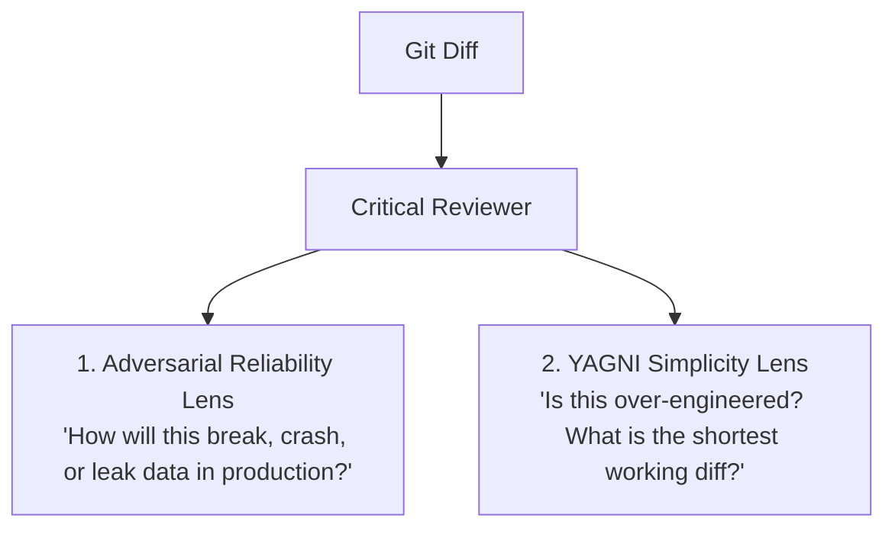

# Critical Reviewer (`critical-reviewer`)

> **An adversarial code reviewer and YAGNI red-teaming skill for AI coding assistants.**

Standard AI code reviewers suffer from two major flaws:
1. **Self-Sycophancy:** They overlook subtle edge cases, race conditions, and unhandled errors.
2. **Academic Bloat:** They love suggesting speculative design patterns, factory wrappers, and heavy abstractions for simple problems.

`critical-reviewer` fixes both by combining **adversarial reliability auditing** with **strict YAGNI principles** (You Aren't Gonna Need It).

---

## The Philosophy: Two Complementary Lenses

When invoked, `critical-reviewer` attacks the `git diff` using two strict lenses:



1. **Adversarial Reliability:**
   - Hunts for null/nil boundaries, empty collections, unicode/timezone drift, and off-by-one errors.
   - Finds concurrency glitches, race conditions, non-atomic multi-step operations, and unhandled async rejections.
   - Probes external failure blast radius (timeouts, network drops, malformed JSON, swallowed exceptions).
   - Audits security and data integrity (injection, missing auth, sensitive data exposure).

2. **YAGNI & Simplicity:**
   - Rejects speculative complexity ("for later" abstractions, wrappers, unused options).
   - Flags dependency bloat (adding a third-party package for something solved by standard library).
   - Enforces the shortest working diff.

---

## The Pair Programming Workflow

For maximum leverage in AI-assisted development, pair this skill with an authoring discipline:

1. **Builder Phase (e.g. `ub-mode`):** Authors the code using strict TDD (Red $\rightarrow$ Green), clean domain boundaries, and type safety.
2. **Reviewer Phase (`critical-reviewer`):** Reviews the resulting diff against adversarial failure modes and strict YAGNI principles before merge.

---

## Installation

### Global Installation (All Projects)
Clone or copy this repository into your global agent skills directory:

```bash
git clone https://github.com/damsonaldson/critical-reviewer.git ~/.gemini/config/skills/critical-reviewer
```

### Per-Project Installation
Add it directly to your repository's workspace customizations:

```bash
mkdir -p .agents/skills/critical-reviewer
curl -sSL https://raw.githubusercontent.com/damsonaldson/critical-reviewer/main/SKILL.md \
  -o .agents/skills/critical-reviewer/SKILL.md
```

---

## Usage

In your agent CLI or chat interface:

```markdown
/critical-reviewer
```
or
```markdown
Run critical-reviewer on my latest changes.
```

### Recommended Workflow (Context-Isolated Review)

For best results, run the review with a clean context:
1. Finish implementing your feature in your development session.
2. Open a **new chat session** (or launch a subagent) in the same project directory.
3. Run `/critical-reviewer`.
4. Take the actionable blockers back to your developer agent to fix.

---

## License

This project is licensed under the [MIT License](LICENSE).
